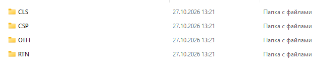
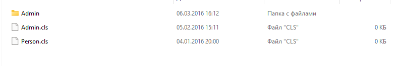

# ISFS — InterSystems Atelier as a Windows drive

[](https://github.com/McUrgd/isfs/actions/workflows/build.yml)

ISFS mounts an InterSystems IRIS/Caché namespace as a Windows drive letter and exposes its
documents (`CLS`, `CSP`, `RTN`, `OTH`) as ordinary files, so Explorer, VS Code and the
command line work against the server without Studio. The drive is a **view** over the
server: there is no local copy, and the server stays the source of truth for content,
timestamps and document existence.

> **Status: proof of concept (v0.1).** Read, write, create, delete, rename and directory
> listing work against a real Atelier endpoint and are covered by reproducible manual
> checks. TLS and compile-on-save are not implemented; see
> [Known limitations](#known-limitations) for the deliberate v1 scope.

The project is based on the `passthrough` file system example from WinFsp and is licensed
under the GNU General Public License version 3 with the WinFsp FLOSS Exception:

    WinFsp - Windows File System Proxy, Copyright (C) Bill Zissimopoulos
    https://github.com/winfsp/winfsp/

The full text of the GPLv3 is in `LICENSE.txt`; the FLOSS Exception and the third-party
notices are in `NOTICE`.

## Contents

- [Demo](#demo)
- [What works](#what-works)
- [Requirements](#requirements)
- [Building](#building)
- [Runtime DLL](#runtime-dll)
- [Usage](#usage)
- [Known limitations](#known-limitations)
- [How it works](#how-it-works)
- [Testing](#testing)
- [Releasing](#releasing)
- [Third-party](#third-party)
- [License](#license)

## Demo




_The namespace root and a package directory: the documents of the server as ordinary files._

## What works

| Operation | Behaviour |
|---|---|
| Directory listing | root → categories (`CLS`, `CSP`, `RTN`, `OTH`) → package levels, derived from the dotted document names |
| Read | the whole document is fetched on open: text lines, or base64 chunks for a binary document |
| Write / save | buffered per handle, `PUT` on flush/cleanup, conditional on the hash taken at open |
| Create | an untouched new file is written as an empty document on cleanup |
| Delete | `DELETE` on the Atelier name; delete-on-close is supported |
| Rename / move | `GET` → `PUT` → `DELETE`, because Atelier has no rename endpoint (not atomic) |
| Metadata | name, category and server timestamp; the size is 0 until the content is fetched |
| Directories | synthetic and read-only: creating, deleting or renaming one is refused |

## Requirements

- Windows with [WinFsp](https://github.com/winfsp/winfsp/) installed. The driver is
  registered as a service, which is what makes mounting a drive letter possible.
- To build: Visual Studio 2022 or 2026 with the C++ desktop workload (x64).
- To run against a server: InterSystems IRIS or Caché with the Atelier web API enabled, a
  namespace and a user allowed to use it.

## Building

```
powershell -ExecutionPolicy Bypass -File scripts\build.ps1
```

`scripts\build.ps1` is the single build entry point: the VS Code tasks (Ctrl+Shift+B) and
the CI workflow both call it. It finds Visual Studio through `vswhere` and enters the
developer shell when `cl.exe` is not already on `PATH`, copies the WinFsp import library
and runtime DLL, and compiles with the flags of the configuration:

| `-Configuration` | Flags | Output |
|---|---|---|
| `Debug` (default) | `/Zi /MT /D_DEBUG /D_CONSOLE /DUNICODE /D_UNICODE` | `isfs\isfs.exe` |
| `Strict` | adds `/W4 /WX` (`/wd4100`; vendored headers exempt) | `isfs\w4\isfs.exe` |
| `Analyze` | adds `/analyze` with `/analyze:WX-` | `isfs\analyze\isfs.exe` |

`Strict` is the build that must stay green — CI enforces it next to the default one.
`Analyze` reports MSVC static-analysis findings as warnings, so it links even when the
analyzer has something to say; read its output instead of trusting the exit code.

The same compilation by hand, from a Developer Command Prompt:

```
cl /nologo /Zi /MT /D_DEBUG /D_CONSOLE /DUNICODE /D_UNICODE ^
   /Ipassthrough /I. ^
   /Feisfs\isfs.exe /Foisfs\ isfs\isfs.c isfs\atelier.c isfs\helper.c cjson\cJSON.c ^
   /link passthrough\lib\winfsp-x64.lib advapi32.lib winhttp.lib
```

Note: the value of `/Fe` and `/Fo` must be attached to the option (no space). The compiler
from Visual Studio 2026 (18.x) does not accept `/Fe <name>` and reports
`D9024: unrecognized source file type`, treating the name as a source file.

WinFsp SDK parts used by the build:

- `passthrough/winfsp/` — headers (`winfsp.h`, `fsctl.h`, `launch.h`), vendored;
- `passthrough/lib/winfsp-x64.lib` — import library, copied from the installed WinFsp SDK
  by `scripts\copy-winfsp-lib.ps1` (not stored in the repository; it is a WinFsp build
  artifact, see `NOTICE`).

Both WinFsp artifacts are copied on every run of the build script; see
[Runtime DLL](#runtime-dll).

## Runtime DLL

The executable imports `winfsp-x64.dll` at load time. WinFsp 2.x keeps it in
`C:\Program Files (x86)\WinFsp\bin` and does not add that directory to `PATH`, so the loader
cannot find it (error 0xc0000135 / "the system cannot find winfsp-x64.dll").

The VS Code build task solves this by copying the DLL next to the executable
(`isfs\winfsp-x64.dll`), so no `PATH` changes are needed. The file is listed in `.gitignore`.
The import library `passthrough\lib\winfsp-x64.lib` is obtained the same way: it is a
WinFsp build artifact and is not stored in the repository.

Both copies are done by scripts that search for the WinFsp installation (registry
`HKLM\SOFTWARE\WOW6432Node\WinFsp`, then the `Program Files (x86)\WinFsp` fallback):
`scripts\copy-winfsp-dll.ps1` for the runtime DLL and `scripts\copy-winfsp-lib.ps1`
for the import library. `scripts\build.ps1` runs both on every build, so a fresh checkout
needs nothing but an installed WinFsp — there is no separate preparation step.

Alternatives:

- add `C:\Program Files (x86)\WinFsp\bin` to the `PATH` environment variable, or
- copy `winfsp-x64.dll` next to `isfs.exe` manually.

## Usage

Mount a namespace of a real server on a free drive letter:

```
isfs.exe -p server:57772 -ns USER -user _SYSTEM -pass secret -m X:
```

The volume root is the namespace itself: `X:\` shows the categories, and a document such as
`User.Person.cls` appears as `X:\CLS\User\Person.cls`.

| Option | Meaning |
|---|---|
| `-p Host:Port` | Atelier server address; the base URL is composed as `http://Host:Port/api/atelier/v1` |
| `-ns Namespace` | namespace to mount; it becomes the volume root and is fixed for the whole mount |
| `-user Login` | login, sent as HTTP Basic on every request |
| `-pass Password` | password, held in memory only |
| `-m X:` | drive letter; mounting on a directory is not supported |
| `-overwrite` | replace the server version on a conflict (`ignoreConflict=1`); off by default |
| `-d DebugFlags` | debug flags; `-1` enables all debug logs |
| `-D DebugLogFile` | debug log file; `-` writes to stderr |

Saves are conditional on the hash of the document that was opened, so an edit is refused
when the server version changed in the meantime. `-overwrite` turns that check off for the
whole mount.

Stop the process with Ctrl+C: it performs a graceful `SvcStop`, releases the drive letter
and — by design — discards buffers that were not flushed (REQ-MOUNT-023).

`isfs.exe` without valid options prints the usage above and exits with a non-zero status.

## Known limitations

The v1 scope is deliberate; each item below is recorded in
[`docs/requirements/`](docs/requirements/README.md).

**Transport and security**

- The scheme is always `http`; TLS is not supported (REQ-CONN-001, REQ-CONN-002). HTTP Basic
  credentials therefore travel unencrypted — deploy a TLS-terminating proxy in front of the
  web gateway.
- `-pass` is visible in the process command line and in the process list (REQ-MOUNT-010).
- No session is created: every request carries the credentials. Proxy support is dropped
  (REQ-CONN-019).

**Filesystem semantics**

- Rename is not atomic: `GET` → `PUT` → `DELETE`, so a failure between the steps can leave
  both documents.
- Directories are synthetic and read-only; creating, deleting or renaming one fails with
  `STATUS_NOT_SUPPORTED`.
- Compile-on-save is not supported (REQ-FS-044).
- The size reported by a listing or a stat is 0; the exact size appears only on an open
  handle whose content was fetched (REQ-FS-003, REQ-FS-006).
- Generated documents are hidden (REQ-MAP-011); system documents follow the server default.
- Document timestamps are server-local and are not converted between time zones (REQ-FS-007).
- Extended attributes, alternate data streams, symlinks, hard links, sparse files,
  compression and quotas are not representable in the Atelier API.
- Unmount discards unflushed buffers silently: no `PUT`, no error (REQ-MOUNT-023).
- Two handles on one document can overwrite each other; the conditional `PUT` turns the
  loser into a conflict instead of silent data loss (REQ-FS-025).
- A namespace is fixed per mount: moving between namespaces is a copy between two mounts.

**Performance**

- There is no content cache: the whole document is downloaded on open, because Atelier has
  no range read.
- Only document descriptors are cached, per category, with a 30 s TTL.

## How it works

WinFsp callbacks are translated into a path model, and the path model into Atelier REST
calls: `\<CAT>\<PKG>\…\<NAME>` is decomposed back into the dotted document name, text is
kept as a line array and binary content as base64, and the whole document is replaced on
save.

- [`docs/architecture/overview.md`](docs/architecture/overview.md) — path model, operation
  mapping, metadata synthesis, error mapping, caching, concurrency;
- [`docs/architecture/api.md`](docs/architecture/api.md) — the Atelier v1 API used here;
- [`docs/requirements/README.md`](docs/requirements/README.md) — the functional requirements
  with stable IDs and per-requirement status.

## Testing

The checks are automated PowerShell scripts. They start a mock server on a free loopback
port, mount `isfs\isfs.exe` on a free drive letter, drive the volume the way Explorer and
the command line do, and verify both the volume and the requests that reached the server.
Each script exits with 0 only when every check passed.

Rebuild `isfs\isfs.exe` first: the checks report what that binary does. `-Drive` and `-Port`
override the free drive letter and the port.

The same three checks run in CI on `windows-2022` after a default and a `/W4 /WX` build; see
[the CI workflow](.github/workflows/build.yml). It installs WinFsp with Chocolatey, mounts a
drive letter, and uploads the mock, service and debug logs of every run as an artifact.

### Mock Atelier server

`scripts\mock-atelier.ps1` serves the endpoints that the file system uses, so no real
server is needed:

- `GET /api/atelier/v1/<namespace>` — namespace information;
- `GET /api/atelier/v1/<namespace>/docnames/<category>` — document listing;
- `GET /api/atelier/v1/<namespace>/doc/<dotted-name>` — document content
  (text with `enc=false`, binary base64 with `enc=true`);
- `PUT /api/atelier/v1/<namespace>/doc/<dotted-name>` — create or replace a document, with
  the `If-None-Match` conflict check;
- `DELETE /api/atelier/v1/<namespace>/doc/<dotted-name>` — delete a document.

Start it:

```
powershell -ExecutionPolicy Bypass -File scripts\mock-atelier.ps1 -Port 18080
```

Mount the volume against it:

```
isfs.exe -p 127.0.0.1:18080 -ns USER -user tester -pass secret -m X:
```

The request log goes to `%TEMP%\isfs-mock-atelier.log` by default; use `-LogFile` to change
it. The namespace and the exposed documents are defined at the top of the script.

### Manual check: unmount discards unsaved data

`scripts\unmount-test.ps1` is a reproducible check of REQ-MOUNT-023. It writes into
`User.Person.cls` and keeps the handle open, so the volume holds a dirty buffer. The mount
is then stopped the way Ctrl+C stops it (a graceful `SvcStop`, not a killed process), and
the script verifies that the write reached the file system, the server received no `PUT` or
`DELETE`, the document content is unchanged, the drive letter was released and the service
log has no `saved the document` line:

```
powershell -ExecutionPolicy Bypass -File scripts\unmount-test.ps1
```

The work directory (`%TEMP%\isfs-unmount-test` by default) keeps the request log of the
mock, the service log and the debug log of ISFS.

### Manual check: renaming documents

`scripts\rename-test.ps1` covers REQ-MAP-016 and REQ-FS-032..036. It renames documents the
way Explorer and the command line do: a text document into another package, a binary
document, a rename over an existing document (refused, then allowed with `MoveFileEx`), a
rename into another category, a rename that only changes the case, a rename of a package
directory (refused) and a rename through a handle with a dirty buffer. The script checks the
requests that reach the server, the content of the target document and the `enc` flag of
binary documents:

```
powershell -ExecutionPolicy Bypass -File scripts\rename-test.ps1
```

The work directory (`%TEMP%\isfs-rename-test` by default) keeps the logs.

### Manual check: deleting documents

`scripts\delete-test.ps1` covers REQ-FS-030 and REQ-FS-037. It fills the descriptor cache of
a category, deletes a document with `[IO.File]::Delete`, opens a document with
`FileOptions.DeleteOnClose` and writes into it, and tries to delete a synthetic directory.
The script verifies that the delete is a `DELETE` of the Atelier name, that the entry leaves
the cache (the listing is reloaded and no longer holds the name), that the dirty buffer of a
delete-on-close handle is not written, and that a directory is refused without a request:

```
powershell -ExecutionPolicy Bypass -File scripts\delete-test.ps1
```

The work directory (`%TEMP%\isfs-delete-test` by default) keeps the logs.

## Releasing

`scripts\release.ps1` runs the release procedure in one command: it checks that `main` is
clean and matches `origin/main`, bumps the `proof of concept (vX.Y)` marker of this README
when it points at an older minor version and commits that, creates an annotated tag, pushes
the branch and the tag, and publishes the GitHub release.

```
powershell -ExecutionPolicy Bypass -File scripts\release.ps1 0.2.0
```

| Option | Effect |
|---|---|
| `-DryRun` | print the plan, change nothing |
| `-NoPush` | stop after the tag is created locally |
| `-NoRelease` | push the branch and the tag, but no GitHub release |
| `-NotesFile notes.md` | use the file as the release notes instead of the notes GitHub generates from the commits since the previous tag |
| `-Prerelease` | mark the release as a pre-release |

The release is created through the GitHub API with `GITHUB_TOKEN` when it is set, otherwise
with the credential git already uses for `origin`. The token is never printed and never
written to disk. The script refuses to run from another branch, on a dirty tree, when
`main` differs from `origin/main`, and when the tag already exists, so a failed attempt
leaves nothing half-published except, in the worst case, a local tag.

## Third-party

The complete list of third-party components and licenses is in `NOTICE`.

- `winfsp/` (headers) and `passthrough/` — WinFsp, Copyright (C) Bill Zissimopoulos,
  https://github.com/winfsp/winfsp/, GPLv3 with the WinFsp FLOSS Exception
  (`passthrough/License.txt`, exception text also in `NOTICE`). `isfs/` is derived
  from the passthrough example and is therefore distributed under the same terms.
- `cjson/` — [cJSON](https://github.com/DaveGamble/cJSON) v1.7.19, MIT license
  (see `cjson/LICENSE`). It parses the UTF-8 JSON answers of the Atelier API;
  the strings of the server are converted to UTF-16 by `Utf8ToWide()` in `isfs/isfs.c`.
  The sources are vendored as they are, so they can be updated by replacing the two files.

## License

ISFS is free software: GNU General Public License v3 with the WinFsp FLOSS Exception.
`LICENSE.txt` holds the GPLv3 text, `NOTICE` the exception and the third-party notices.
The exception forbids mixing a WinFsp-based program with proprietary software, and the
parts derived from the passthrough example (GPLv3) cannot be relicensed; a closed-source
distribution needs a commercial WinFsp license and a rewrite of the derived code.
